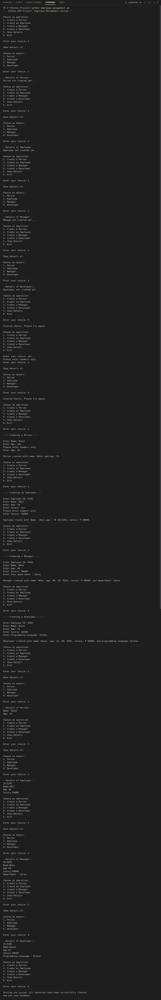

# 🧑‍💼 Employee Management System

**A menu-driven Python console application built to practice Object-Oriented Programming**


---

## 📌 1. Project Title

**Employee Management System** – Python OOP Project

---

## 📝 2. Project Description

This project is a command-line application that lets the user create and view details of different kinds of people in a company: a **Person**, an **Employee**, a **Manager** and a **Developer**.

It was developed to demonstrate the core Object-Oriented Programming concepts in Python – classes and objects, constructors, encapsulation, inheritance, method overriding and destructors – in a small and easy-to-understand program.

The user interacts through a numbered menu in the terminal. Data is entered from the keyboard, and the details of each object can be displayed at any time.

---

## ✨ 3. Features

- 📋 Menu-driven console interface with 6 options
- 👤 Create a **Person** (name, age)
- 🧑‍💼 Create an **Employee** (employee ID, name, age, salary)
- 🏢 Create a **Manager** (employee details + department)
- 💻 Create a **Developer** (employee details + programming language)
- 🔍 Show the details of any created object
- ⚠️ Friendly message when viewing an object that has not been created yet
- ✅ Input validation for numeric fields (age, salary, menu choice) using the `read_int()` helper
- 🛡️ Handles invalid menu choices without crashing
- 💰 Salary displayed with the rupee symbol (₹)

### 🧩 OOP Concepts Used

| Concept | Where it is used |
|---|---|
| Classes & Objects | `Person`, `Employee`, `Manager`, `Developer` |
| Constructor (`__init__`) | Every class initialises its own data |
| Encapsulation | Private attributes `__employee_id` and `__salary` in `Employee` |
| Inheritance | `Manager` and `Developer` inherit from `Employee` |
| `super()` | Child classes reuse the parent's `__init__`, `display()` and `setdata()` |
| Method Overriding | `display()`, `setdata()` and `getdata()` are redefined in child classes |
| Destructor (`__del__`) | Defined in `Employee` |

---

## 🛠️ 4. Technologies Used

| Category | Details |
|---|---|
| 🐍 Language | Python 3 |
| 📚 Libraries | None – only Python built-in functions |
| 🖥️ Editor / IDE | Visual Studio Code (any editor works) |
| 💬 Interface | Command line / terminal |

---

## 🚀 5. How to Run / Installation

### ✅ Prerequisites

Python 3.x installed on your computer. Check with:


python --version

> On some systems use `python3 --version`.

### ▶️ Steps

1. 📥 **Download or clone** the project folder.
2. 📂 **Open the folder** in VS Code (or any terminal).
3. 🖥️ **Open the terminal** (VS Code: `Terminal` → `New Terminal`).
4. ⚙️ **Run the program:**
   ```bash
   python employee_management.py
   ```
   > Use `python3 employee_management.py` on Linux / macOS if needed.
5. 🔢 **Follow the on-screen menu** and enter your choices.

---

## 📁 6. Project Structure

```
├── main.py
├── output.png 
└── README.md                
```
## output / screenshots 



### 🧱 Class structure inside `employee_management.py`

```
read_int()              -> helper function for validated number input

Person                  -> name, age

Employee                -> employee_id (private), name, age, salary (private)
 ├── Manager            -> + department
 └── Developer          -> + programming_language
```

---

## 👨‍💻 7. Author / Developer

**Kunal Vaghela**

---
